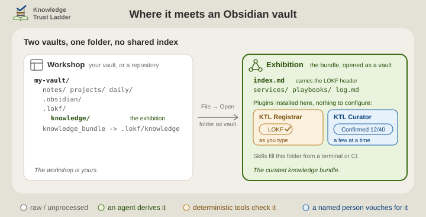

# Architecture

This page says what a knowledge bundle is, which role KTL Registrar plays in keeping one, and how the bundle sits beside your own notes. It is for anyone deciding whether to use the plugin, and for anyone who keeps a bundle with it. [Install](install.md) gets it running, and [Using it](using.md) lists the report panel, the in-editor diagnostics, the commands, the settings and the read-only API for other plugins.

<p align="center">
  <picture>
    <source media="(prefers-color-scheme: dark)" srcset="../.assets/ktl-obsidian-plugins-card-dark.svg">
    
  </picture>
</p>

A bundle is a folder of Markdown notes in the [Linked Open Knowledge Format](https://lokf.nolan-nichols.com/) (LOKF): one concept per note, a few properties on each, and an `index.md` at the root that names the bundle. The [`knowledge-trust-ladder`](https://github.com/noelmcloughlin/knowledge-trust-ladder) skills build one beside whatever they are run on: a code repository, a vault of notes, a folder of documents.

This plugin is the **registrar** of that family: it checks that every record is well-formed. Its sibling [KTL Curator](https://w3id.org/ktl/curator/) records what a person decides about each record. Neither reaches a verdict of its own. The judging stays with the person.

The skills' [architecture page](https://w3id.org/ktl/docs/architecture/#four-skills-three-lines-of-the-poem) sets out all the roles, and [the fifth role](https://w3id.org/ktl/docs/architecture/#the-fifth-role-which-is-not-a-skill) covers the two plugins. For anyone who works under the **three lines of defence**, this plugin is second-line work: it keeps the format and never judges truth. [docs/three-lines.md](https://w3id.org/ktl/docs/three-lines/) says where the rest sit.

Obsidian is optional in both directions: the skills rely on `lokf validate`, not on this plugin, and the plugin works on any LOKF bundle however it was made. The format is all they share.

## Two vaults

Your everyday Obsidian vault is the **workshop**. The bundle is the **exhibition**: a second, smaller vault that you open through the `knowledge_bundle` link the skills leave at the root of the host. The two never index the same file, so nothing here touches your notes.

<p align="center">
  <picture>
    <source media="(prefers-color-scheme: dark)" srcset="../.assets/ktl-two-vaults-dark.svg">
    
  </picture>
</p>

The skills' playbook [Open the knowledge bundle in Obsidian](https://w3id.org/ktl/knowledge/playbooks/open-bundle-in-obsidian) records how the `knowledge_bundle` doorway behaves on each host. If the link is missing, make it with `ln -s .lokf/knowledge knowledge_bundle` (or `mklink /J knowledge_bundle .lokf\knowledge` on Windows), or open `.lokf/knowledge` by path.

## Which folder is the bundle

With nothing configured, the vault decides:

1. A root `index.md` with a LOKF header means **the whole vault is the bundle**, which is the case whenever you open `knowledge_bundle` as a vault.
2. Otherwise a top-level `knowledge_bundle/` folder with its own `index.md` is the bundle, and notes outside it are left alone.
3. Otherwise there is **no bundle**. Nothing is scanned and every command says so.

Two settings widen that under *Settings → Scope and performance*:

- **Bundle root folders**: for a bundle that sits as a folder inside a larger vault, or several of them (`bird-watching, projects/art-portfolio`). Each is an independent bundle with its own `index.md` and `base_iri`. Notes outside every listed folder are ignored. Obsidian indexes such a folder like any other, so exhibits mix with your notes in search, graph and link suggestions. The skills install the bundle as a separate vault instead, and the playbook's [last section](https://w3id.org/ktl/knowledge/playbooks/open-bundle-in-obsidian#why-the-bundle-is-never-a-real-folder-inside-a-vault) says why.
- **Treat the vault root as the bundle**: a break-glass switch for a vault that really is a bundle but whose root `index.md` has no header yet.

A folder inside a dot-folder is accepted, but it is scanned only if something has put it in Obsidian's index. The community plugin *Hidden Folders Access* does that. Otherwise the scan says so, rather than reporting an empty bundle as clean.

## Privacy

The plugin makes no network requests, sends no telemetry and uses no external services. It reads the Markdown in the open vault and writes only when you run a command that edits a note: the header, safe-fix, promote-relations and affordance commands, and the report's *Fix this finding* and *Silence this note* actions. Settings live in the vault's own plugin data.

## Development

See [CONTRIBUTING.md](../CONTRIBUTING.md). The layout follows the upstream [obsidian-sample-plugin](https://github.com/obsidianmd/obsidian-sample-plugin). `npm run lint` runs Obsidian's own `eslint-plugin-obsidianmd` ruleset.

```text
src/
  main.ts           plugin lifecycle: commands, status bar, vault scan, the editor aids
  validator.ts      the LOKF rule set and bundle-root resolution - import-free, runs under plain Node
  report-view.ts    the side-panel report
  scaffold-modal.ts the two-choice modal behind "Insert the bundle's semantic header"
  public-api.ts     the read-only API offered to sibling plugins
  settings.ts       declarative settings tab (Obsidian 1.13+)
  ...               quick-switchers, autocomplete, safe fixes, affordances, relation promotion - one module each
scripts/
  smoke-test.ts     validator fixtures + whole-bundle golden fixtures (npm run smoke-test)
  build-vocab.mjs   regenerates src/lokf-vocab.json from a pinned lokf.yaml (a maintenance step)
  fixtures/         frozen copy of the ktl-sidecar template skeleton the smoke test validates
docs/               the reasoning behind the checks
.lokf/              this repository's own LOKF knowledge bundle
```

`src/validator.ts` takes already-parsed frontmatter and imports nothing, so the whole rule set runs under plain Node via `npm run smoke-test` with no Obsidian install. `src/main.ts` does the parsing, with Obsidian's own `parseYaml`.

## This repository's own bundle

This repository keeps a bundle of its own under `.lokf/knowledge/`, maintained by the `knowledge-trust-ladder` skills, which a scheduled [workflow](../.github/workflows/knowledge-librarian.yaml) installs at run time. It is what the docent answers from, and none of it is part of the plugin. [CONTRIBUTING.md](../CONTRIBUTING.md#development-setup) says which skills you need to contribute to it.

## Read on

| | |
| --- | --- |
| How to get a bundle, where to install the plugin, and the quick start | [install.md](install.md) |
| The report panel, the in-editor diagnostics, the commands, the settings and the read-only API for other plugins | [using.md](using.md) |
| What LOKF adds over plain OKF, the OKF v0.2 rules checked underneath, what is left unchecked, why almost everything is a warning, and what each host layout means for the plugin | [for-the-curious.md](for-the-curious.md) |
| The roles, the trust ladder and the two plugins, on the skills' own pages | [architecture](https://w3id.org/ktl/docs/architecture/), [the bundle in Obsidian](https://w3id.org/ktl/docs/obsidian/) |
| Contributing, the code of conduct and the AI covenant; reporting a security issue | [CONTRIBUTING.md](../CONTRIBUTING.md), [CODE_OF_CONDUCT.md](../CODE_OF_CONDUCT.md), [AI_COVENANT.md](../AI_COVENANT.md), [SECURITY.md](../SECURITY.md) |

## Credits

- [Nolan Nichols](https://lokf.nolan-nichols.com/), creator of [LOKF](https://lokf.nolan-nichols.com/specification/) and its [toolkit](https://github.com/nicholsn/lokf).
- The [LinkML Community](https://linkml.io/), creators of [LinkML](https://linkml.io/linkml/), the schema language LOKF is written in.
- [Introducing the Open Knowledge Bundle, Google blog](https://cloud.google.com/blog/products/data-analytics/how-the-open-knowledge-format-can-improve-data-sharing), creator of the Open Knowledge Format specification.
- [LLM Wiki, Karpathy](https://gist.github.com/karpathy/442a6bf555914893e9891c11519de94f), a pattern for building personal knowledge bases using LLMs.
- [obsidian-sample-plugin](https://github.com/obsidianmd/obsidian-sample-plugin), whose build, lint and release layout this repository follows.
- [knowledge-trust-ladder](https://github.com/noelmcloughlin/knowledge-trust-ladder), the registrar role this plugin fills in the editor, and whose bundle template the smoke test validates.
- [KTL Curator](https://github.com/noelmcloughlin/obsidian-ktl-curator), the sibling plugin, forked from this one and sharing the bundle-root plumbing in `src/validator.ts`.

We know of no other tool that checks the LOKF semantic layer. Validators for the plain OKF v0.2 layer beneath it exist, such as [OKF Enforcer](https://github.com/MartinForReal/okf-enforcer). This plugin checks the same base rules, so none is required.

## License

[Apache License 2.0](../LICENSE); see also [NOTICE](../NOTICE).
